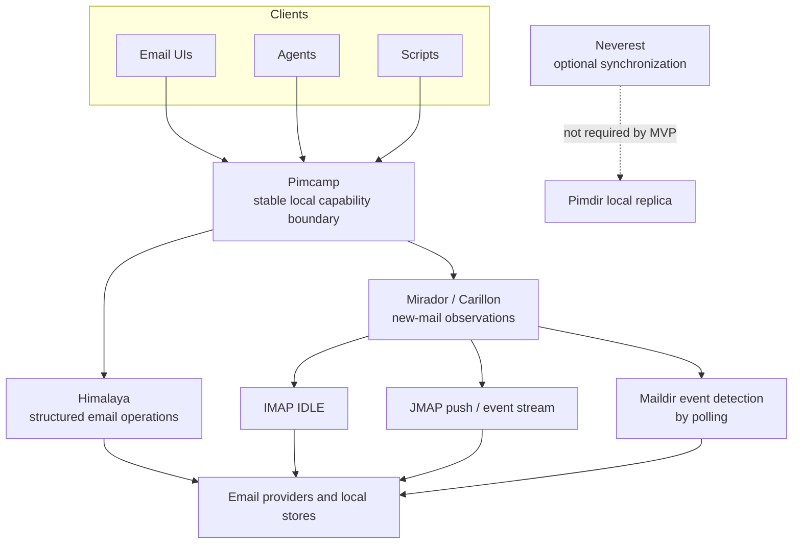

# Pimcamp

Pimcamp is a stable local email capability boundary for user interfaces,
agents, and scripts. It gives these clients one structured seam instead of
making them depend on a specific command-line tool, provider, or email
protocol.

Pimcamp's seven-operation v1 boundary is not a full email app. The additive
private v2 surface provides a message-specific reader and reply composer; it
does not add a sync engine, search index, or general email automation platform.

The authenticated v2 browser reader and plain-text reply composer use separate
session, message-read, reply-prepare, explicit-submit, and read-only send-status
routes. Message content is shown as inert text with remote content off. The
browser surface leaves every `pimcamp.v1` request envelope and operation behavior
unchanged. Production integration and release acceptance remain pending.

Mail sessions return idle and absolute deadlines. Foreground edits and protected
user actions call `POST /mail/api/session/activity` with the current same-origin
cookie and CSRF token; background status checks and visibility changes do not
renew idle time. Sessions expire at 30 minutes idle or 12 hours absolute,
whichever comes first. Human logout uses `POST /mail/api/session/logout`, hides
private content, and keeps same-browser reply and send-operation records for
later authorized recovery.

A generic account setup UI is included in this development tree and its installer;
it has not yet passed release acceptance. See the [onboarding design specification](docs/onboarding-ui-spec.md)
and [integration requirements](docs/onboarding-integration.md). This setup UI
configures the stack; mailbox viewers and composers remain independent clients.

The [design preview](ui/onboarding/index.html) can be opened directly from a
local checkout. It uses clearly labeled demo data and never connects or saves
an email account. Its [design notes](ui/onboarding/DESIGN.md) describe the screens
and integration boundary. Run `node tests/browser_onboarding.mjs ui/onboarding`
with Node and Chromium installed for the optional browser layout checks.

### Install the development candidate

Requires Linux and Python 3.12 or newer. From the checkout:

```sh
python3 scripts/install --version onboarding-candidate
~/.local/bin/pimcamp-setup
```

The installer includes the HTML/CSS, setup backend, and credential helpers. It
does not install dependencies, change account data, or overwrite an existing
release directory. Choose a new version name for a subsequent candidate.
Himalaya 2.1.0 and Carillon 0.1.0 must be installed separately; supply their
absolute paths with `--himalaya` and `--carillon` if they are not on PATH.

Setup opens an authenticated browser session on the fixed loopback port 33281.
IMAP & SMTP accepts your email address, editable server settings, and shared or
separate login credentials. Passwords go to an unlocked Secret Service keyring
through `secret-tool`, not into configuration files. Before asking for an email
password, setup checks that keyring and lets you create it or unlock it with its
own separate password. A headless installation still needs a working Secret
Service provider; installing the utility alone does not provide one. No test
email is sent during setup.

Google requires an installation-owned OAuth application and Ortie 2.2.0. The
development UI's **Set up Google sign-in** flow guides project/client registration
at Google, securely imports the downloaded Desktop-client JSON, and returns to
account sign-in. Install Ortie first (or supply its absolute path with `--ortie`).
The imported secret is stored in the encrypted vault; the registration is loaded
automatically on subsequent setup launches. See the [flow specification](docs/google-registration-flow.md) and
[integration notes](docs/onboarding-integration.md) for application options and
the remaining verification work. Opening the HTML file directly is only a demo;
use `pimcamp-setup` to configure a real account.

### Agents setting up Pimcamp for a user

Follow the [agent-assisted setup guide](docs/agent-assisted-setup.md). It covers
installation checks, encrypted password storage, opening the **live HTML UI**
locally or through SSH, user handoffs, expired setup attempts, and verification.
Run the setup commands for the user; ask them only for private input or provider
consent. Do not ask for passwords in chat or substitute the demo HTML preview.

A **password vault** (called a keyring on Linux) keeps email passwords and tokens
encrypted on the mail host. A new vault needs a new password chosen by the user;
an existing vault needs its existing password. This is separate from an email
password and may be required again after restart. The setup UI explains this and
creates or unlocks the vault on its own screen before asking for any email
password; it never resets an existing vault. If the UI cannot reach the host's
keyring daemon, the vault is created or unlocked on the host instead.

## Where Pimcamp fits



Pimcamp uses components from the Pimalaya ecosystem behind its boundary:

- [Himalaya](https://github.com/pimalaya/himalaya) provides structured email
  operations.
- [Mirador](https://github.com/pimalaya/mirador), now named Carillon, provides
  change observation through IMAP IDLE, a JMAP push/event stream, or Maildir
  event detection by polling.
- [Neverest](https://github.com/pimalaya/neverest) can synchronize email when
  a deployment needs a Pimdir local replica. Synchronization is optional and
  is not required by the MVP.

A future private adapter composition could place Maildir and notmuch beneath
the same Pimcamp boundary. That composition would reuse the existing public
capabilities. It is not part of the MVP and does not add a capability.

## MVP capabilities

The public `pimcamp.v1` operation surface contains seven capabilities:

1. `list` — list current message summaries.
2. `read` — retrieve the current form of a selected message.
3. `compose` — create a structured composition without sending it.
4. `reply` — create a structured reply from the current source message.
5. `send` — send a composition or reply.
6. `junk` — file a selected message as junk by the strongest supported method.
7. `subscribe_new_mail` — stream normalized new-mail observations so a client
   can retrieve authoritative state through Pimcamp.

## Private message viewer API (`pimcamp.v2`)

Agent link-generation instructions are in [the Pimcamp skill](skills/pimcamp/SKILL.md#private-message-viewreply-links-v2).

The v2 extension is separate from the seven `pimcamp.v1` operations; v1 request
schemas and results remain unchanged. Its agent operations are `accounts`,
`account_info`, `list_account`, and `issue_link`. V2 requests use the same
JSON/stdio boundary with `contract_version: "pimcamp.v2"`. A client needs the
operation grant and an explicit `account_ids` allowlist. `issue_link` accepts
an account ID and a Pimcamp source reference returned by `list_account`. It
returns either a linked account/locator/URL result or `cannot_link` with a
reason and no URL. It never guesses an identity from a subject, Message-ID, or
folder UID.

The v2 operation inputs are closed objects: `accounts` takes `{}`;
`account_info` takes `{"account_id": "…"}`; `list_account` takes
`{"account_id": "…", "limit": 25}` and may include `cursor`; and
`issue_link` takes `{"account_id": "…", "source_ref": "…"}`. A successful
link result contains `status: "linked"`, `account_id`, `locator`, and an
absolute URL. A rejected link contains `status: "cannot_link"` and a
normalized `reason`, with no locator or URL.

The browser routes are `GET /mail/m/{locator}`, the authenticated static assets
`GET /mail/assets/{name}` (`mail.css`, `mail-client.js`, `mail-drafts.js`,
`mail-text.js`, or `mail-app.js`), `POST /mail/api/session`,
`POST /mail/api/session/activity`, `POST /mail/api/session/logout`,
`GET /mail/api/v2/messages/{locator}`, `POST /mail/api/v2/replies/prepare`,
`POST /mail/api/v2/replies/{operation_id}/submit`, and `GET /mail/api/v2/accounts/{account_id}/send-status/{operation_id}`. Reply
preparation and status lookup do not send. Only the explicit browser submit
route can call the mail transport. Status is a read-only projection of the
durable receipt; an optional read-only reconciler may provide an authoritative
provider result. Without that evidence, an uncertain result remains `unknown`.

The executable `scripts/pimcamp-mail --config /private/pimcamp/config.json --port 33282`
mounts the WSGI application on `127.0.0.1` only, behind an existing private
Tailscale Serve HTTPS proxy. The port is an example and must be explicitly chosen.
The runner consumes the proxy-replaced `Tailscale-User-Login` assertion and an
explicit server-side `mail_principals` mapping. Missing assertions or grants deny
access; URLs, network membership and CLI credentials confer no browser grants.
This assumes the approved private Serve ingress; the loopback listener is not a
general-purpose header-authenticated public endpoint. It does not configure Serve
or start a service on installation. Real proxy/login behavior remains activation
evidence. Requests are not access-logged. Sessions are process-local and volatile;
config/grant/address changes require a runner restart, then browser renewal.
The runner supplies no SMTP status reconciler: uncertain sends stay unknown.

An operations command used for stable links must return `identity_evidence`
with each listed message when `include_identity_evidence` is true. The closed
object has `namespace`, `key`, `continuity` (`native` or `mapped`), `backend`,
`folder`, and nullable `generation` fields. The same command must implement
`resolve_identity` with that object and return `matches`, each containing one
`adapter_id`. Zero matches, multiple matches, missing evidence, or unsupported
resolution cannot produce a link. The adapter must be able to resolve the
evidence after supported folder moves and reconnects; a subject, RFC 5322
Message-ID, or folder-local UID alone is not evidence of that guarantee. The
Himalaya adapter provides native identity only when explicitly configured for
Gmail. Other backends, including generic IMAP, return `cannot_link` without
authoritative evidence. Dovecot X-GUID same-folder lookup alone does not establish
cross-folder, rebuild or duplicate continuity and is not enabled here.

A Himalaya adapter inside `mail_accounts` may explicitly set `"backend": "gmail"`
to pin its reads and lists to the native Gmail backend without Auto/IMAP fallback.
Configure `identity_capability: "native"` and the account's `address` alongside
that selector. Listed native IDs receive evidence; resolution uses direct Gmail
metadata lookup and subsequent raw reads use that same backend. The original
folder is not used as durable identity. Initial listing still covers the configured
collection, not an account-wide search. Lower lookup failures remain unavailable
unless positively classified; they are not guessed to mean deletion.
The v1 top-level adapter schema and default behavior remain unchanged.

Locators bind to the stable local account ID plus configured `address`, separately
from editable reply From choices. Changing that address under an ID makes old
locators fail clearly with `conflict` before adapter I/O; old source references
return URL-free `cannot_link`. A missing address cannot issue links. Earlier v2
locators without this binding also fail clearly and must be regenerated from an
authoritative source. No profile/incarnation lookup or identity fallback is used.
Isolated native fixtures are application evidence, not real provider acceptance.

For a browser reply, the operations adapter receives the selected `sender`
alongside the source-derived threading context and edited composition. It must
use that address for both the message From header and transport envelope.
`selectable_from` is the configured authority list; setting it requires a
deployment decision backed by account/provider evidence.

`POST /mail/api/session` accepts `{}` and returns `principal_id`, `csrf_token`,
authorized `accounts`, `idle_deadline`, `absolute_deadline`, and an HttpOnly,
Secure, SameSite cookie. Sessions default to a 30-minute idle limit and a
12-hour absolute limit; equality with either deadline is expired, and activity
never moves the absolute deadline. Session establishment reuses a valid cookie
for the same verified principal, preserving its CSRF token and both deadlines
while checking current account authorization. This lets multiple message tabs
share the browser session. An expired, invalid, logged-out, or different-principal
cookie requires a fresh session. Missing or expired sessions return HTTP 401
with the flat v2 error fields `code: "session_expired"`, `message`, and
`retryable: false`. Actual origin, CSRF, account, or principal authorization
failures remain HTTP 403 `permission_denied`.

`POST /mail/api/session/activity` accepts only `{}` under the current session,
same-origin check, and CSRF token. It returns `idle_deadline` and
`absolute_deadline`; it is the only request that renews the idle limit. The
authenticated foreground browser calls it before the associated deliberate
read/navigation, composing edit, prepare, or explicit Send action. Background
refresh, status polling, health checks, visibility alone, and remote message
content do not renew the session. A `session_expired` response never replays a
send: preserve local draft and operation identity, renew only on the user's
action, then query read-only status before a later explicit Send.

`POST /mail/api/session/logout` accepts `{}` with the same origin and CSRF
checks, invalidates only the current mail session, clears its cookie, and
returns 204. The client hides private content while retaining local draft and
operation data; logout does not delete drafts or submit mail. An unavailable
status lookup returns HTTP 503 `status_unavailable` with `retryable: true`, not
a guessed send result.

Message GET
returns `account_id`, `account_label`, `locator`, a nested `source` object, and
readable `body_parts`. `POST /mail/api/v2/replies/prepare` accepts
`{"locator": "…", "body_text": "…"}` and returns `operation_id`, account/source
context, and a nested `reply` object containing `from_choices`,
`selected_from`, editable `to`/`cc`/`bcc`, `subject`, and `body_text`.
`POST /mail/api/v2/replies/{operation_id}/submit` accepts the reviewed
`account_id`, `locator`, `from` address object, `to`/`cc`/`bcc` address arrays,
`subject`, and `body_text`. The server re-resolves the source and derives
threading from it. Session creation requires the configured origin and the
trusted upstream identity; later POSTs also require the session CSRF token.
The message GET returns readable text parts; HTML parts are converted to
text without executing message content or loading remote content. Send status
returns one of `absent`, `pending`, `sent`, `not_submitted`, or `unknown`, plus
`retry_eligible`; only positively established `not_submitted` is retryable.
The status GET leaves an expired in-progress claim unresolved until a submission
claim safely establishes a terminal state.

Pimcamp is an independent project. It is not an official Pimalaya project and
is not affiliated with or endorsed by Pimalaya.

## Build authority

- Spec artifact: `art_4e44121c`
- Canonical spec commit: `bf8c76f8879184bb5dadcb23d7930d7e3ecbb509`
- Spec SHA-256: `05ba0b738f9cac4413c7bf859f9ba92b2319ffe0368906f68b261e211b44983b`
- Independent reviewed-clean verdict: `att_c06fccb3`
- Review report: `art_89006412`

The reviewed specification is the product authority. A ruled amendment for
truthful Mirador startup semantics is present at tightbeam-specs commit
`c898bd4e91b7d8b6f92f2ef421d7845e6868f2be`, artifact `art_8bc4f300`, SHA-256
`cda69c3763eb5e03efaa577686af196bd6a955b13ab9aa672bb1e16d37a7f542`.
Its independent reviewed-clean verdict is
`att_03f441dc-474f-47f5-9e0d-ce773d45146a`; its clause report is
`art_df06241c`, SHA-256
`0ef89997f2d334ca36754fffef89430d94f167b2f0d75fb610b12375e464d2a8`.

## Runtime

Agents operating email through Pimcamp should install the
[Pimcamp skill](skills/pimcamp/SKILL.md). Copy the `skills/pimcamp` directory
into the agent's skill directory (for example `~/.codex/skills/pimcamp` or
`~/.claude/skills/pimcamp`). The skill describes the public operations,
credential handling, pagination, mutation retries, and notification semantics.
Keep deployment hosts, account identities, and credential-helper paths in your
own environment/topology documentation; they are not part of the reusable skill.

See [runtime installation](docs/runtime-installation.md) for release layout,
dependency and credential requirements, and
[Runtime acceptance](docs/runtime-acceptance.md) for the verified real-mail
self-send, notification, and retrieval sequence from a test environment. The
published v0.1.0 runtime release predates the included onboarding candidate
described above.

Pimcamp requires Linux, Python 3.12 or later, and an owner-only deployment
configuration. The repository-local executable is `./pimcamp`.

Finite calls read one request value from standard input, write one JSON line to
standard output, and exit with status 0 or 1. A subscription keeps standard
output open for normalized event lines and closes its lower process on client
`SIGTERM`.

The default configuration path is
`$XDG_CONFIG_HOME/pimcamp/config.json`, or
`~/.config/pimcamp/config.json` when `XDG_CONFIG_HOME` is absent. Deployment
may set `PIMCAMP_CONFIG` before it launches the client process. The
configuration file, the state directory, the SQLite state file, and mutation
lock files must be owner-only.

The base configuration below is the `pimcamp.v1` shape. A v2 deployment may
add top-level `mail_origin` (an HTTPS origin), `mail_accounts` and `mail_principals`.
The last is an explicit map of one approved operator login to approved local
account IDs, for example `{"operator@example.test": ["account-a", "account-b"]}`;
no mapping means no browser access, and unknown account IDs are rejected.
Each entry in
`mail_accounts` has `label`, `operations_adapter`, `primary_from`,
`selectable_from`, `alias_discovery_state`, and `identity_capability`; stable links
also require its configured `address`. Each
selectable sender carries its address, authority provenance, and validity;
only entries marked `valid` can be selected for a browser reply. Credentials
may add `account_ids`; absent account grants mean v2 access is denied. A
configured primary From does not by itself prove that the provider authorizes
it for sending. Set identity capability to `unknown` until the adapter has
evidenced a native or mapped move-stable identity.

The real operations adapter targets Himalaya 2.1.0 source commit
`bbdfb09b8b8841a509df463a80066531fb81af04` and its locked
`pimalaya-cli 0.2.4` JSON printer. Its v1 base configuration has this shape:

```json
{
  "credentials": {
    "<sha256-of-high-entropy-client-credential>": {
      "client_identity": "local-client",
      "grants": ["list", "read", "compose", "reply", "send", "junk", "subscribe_new_mail"]
    }
  },
  "adapter_wait_seconds": 10,
  "state_path": "/private/pimcamp/state.sqlite3",
  "operations_adapter": {
    "kind": "himalaya",
    "executable": "/usr/bin/himalaya",
    "account": "personal",
    "config_paths": ["/private/himalaya/config.toml"],
    "inbox": "INBOX",
    "junk_mailbox": "Junk",
    "from": {"name": "Sender", "address": "sender@example.test"}
  },
  "observation_adapter": {
    "kind": "mirador",
    "executable": "/usr/bin/carillon",
    "account": "personal",
    "backend": "imap",
    "config_paths": ["/private/carillon/config.toml"]
  }
}
```

The Himalaya adapter uses explicit SMTP envelope recipients. It does not place
`Bcc` in the RFC 5322 headers. It reports `move_to_junk` only when deployment
positively configures `junk_mailbox`; current inspected Himalaya source provides
no proved spam-reporting call, so the adapter does not claim one.

The real observation adapter targets current Mirador/Carillon 0.1.0 source
commit `b431f9f793eecdb6e65cc5437318152a7def02c0`. Carillon reports arrivals
through configured hooks and exposes no post-open watch readiness event.
Pimcamp starts one Carillon execution with a private, owner-only overlay that
changes only that execution's `on-message-added` command. The command emits a
constant internal signal and copies no Carillon event field. Pimcamp returns
`{status: "started"}` after the execution starts. This result does not claim
that the backend watch is live; the first normalized event is the real watch
evidence. The selected backend must be `imap`, `jmap`, or `maildir`, and the
named Carillon account must configure that backend and its inbox collection.
Use a dedicated Carillon account configuration with no notification hook and
no hook other than `on-message-added`; Pimcamp rejects extra hooks so their
commands cannot share the private event pipe.

A finite invocation looks like this:

```sh
printf '%s' '{"contract_version":"pimcamp.v1","client_credential":"<secret>","input":{"limit":25}}' | ./pimcamp list
```

Do not place a real credential in shell history in normal use. Supply the
request through the calling program's private input path.

## Safety properties

- Authorization finishes before adapter I/O or mutation reservation.
- Message references and cursors are opaque Pimcamp values.
- List, read, reply-source lookup, and notification-triggered refresh use the
  current operations adapter. Notifications are hints, not mail truth.
- Send and junk reserve a durable receipt before one adapter attempt. A reused
  mutation ID replays its terminal result or returns `conflict`; ambiguity is
  recorded as `outcome_unknown` and never retried implicitly.
- One deployment-owned absolute deadline bounds all finite lower phases. A
  client `SIGTERM` starts a fresh observation teardown deadline.
- Public errors and ordinary diagnostics omit mail content, credentials, and
  raw lower material.

## Verification

Run the repository gate:

```sh
python3 -m compileall -q src tests pimcamp
python3 -m unittest discover -s tests -v
python3 -m unittest tests.test_process_boundary -v
```

The process suite runs the same inherited public contract checks against two
independent private-port pairs. These deterministic ports are not lower-adapter
fixtures and claim no Himalaya or Mirador syntax.

Run the credentialed journey separately:

```sh
python3 -m unittest tests.test_live_adapters -v
```

The live journey mutates the configured test account. A private runner must set
the non-secret controls `PIMCAMP_LIVE_ENABLE=1`, `PIMCAMP_LIVE_CONFIG`,
`PIMCAMP_LIVE_RECIPIENT`, `PIMCAMP_LIVE_HIMALAYA_VERSION`,
`PIMCAMP_LIVE_MIRADOR_VERSION`, and `PIMCAMP_LIVE_EVIDENCE_FILE`. Set the
evidence control to an absolute path for a new file outside the repository, in
an existing directory accessible only to its owner. The runner writes a private
JSON Lines record with redacted
command/output captures from the real lower tools, their digests and versions,
observed call counts, and the content-free start/event/query order. Addresses,
message identifiers, subjects, bodies, credentials, and local paths are removed
before capture data is written. The runner does not overwrite an existing
evidence file. Each configured tool version must match an exact version token
printed by that tool; the record includes the observed token and output digest.

Run the journey in an interactive terminal: the test requests the Pimcamp
client credential with hidden input after checking the configuration, that the
source is integrated on main, the evidence destination, and tool versions. Do
not set `PIMCAMP_LIVE_CREDENTIAL`; the test removes that obsolete variable before
starting child processes. It passes the credential only in the public request
on Pimcamp's stdin, never in argv, environment, or test failure output. If
hidden terminal input is unavailable, the live test skips without reading a
credential.

By default, the recipient must automatically reply with the generated unique
token. The test proceeds only after it finds and reads that matching reply,
then sends a reply and files the matching message as junk before confirming it
is gone. For a release whose reviewed acceptance amendment permits a consenting
human return, `PIMCAMP_LIVE_HUMAN_RETURN=1` opts into checking that the
configured recipient differs from the selected account's sender and that the
token-bearing return came from that recipient. The responder and usable route
must be arranged before the journey. The default automatic-reply expectation
remains in effect when this option is unset. A human-return record covers only
that journey; it does not prove automatic responder behavior or unattended
repeatability.

An explicit local skip is honest but is not release evidence. Release evidence
requires the real journey to pass, real redacted captures, exact tool versions,
the selected junk mechanism, adapter-call counts, and the content-free
start/event/query ordering trace. See `tests/fixtures/README.md`.
